# WhatsApp Business Catalogue

Generated by `build.mjs`. Edit the items there and rerun; don't edit this file by hand.

**Adding items:** WhatsApp Business → Tools (or Settings → Business tools) → Catalogue → Add new item.
Upload the image, then copy each field below. Prices are suggested starting prices; change them in `build.mjs`.

**Share link:** once the catalogue is live, it can be opened at https://wa.me/c/263787541207

**Pricing notes** (send these when a client asks for a quote):

- All prices are starting prices in US dollars, not fixed quotes.
- The final price depends on features, number of users, integrations, data migration and delivery timeline.
- Hosting, domain renewals, GPS hardware, SIM and data charges, payment processing fees, SMS and WhatsApp charges, and paid third-party subscriptions are charged separately unless your written quote includes them.
- For larger projects, I agree a written scope with you before giving the final quote.

## 1. Business Website

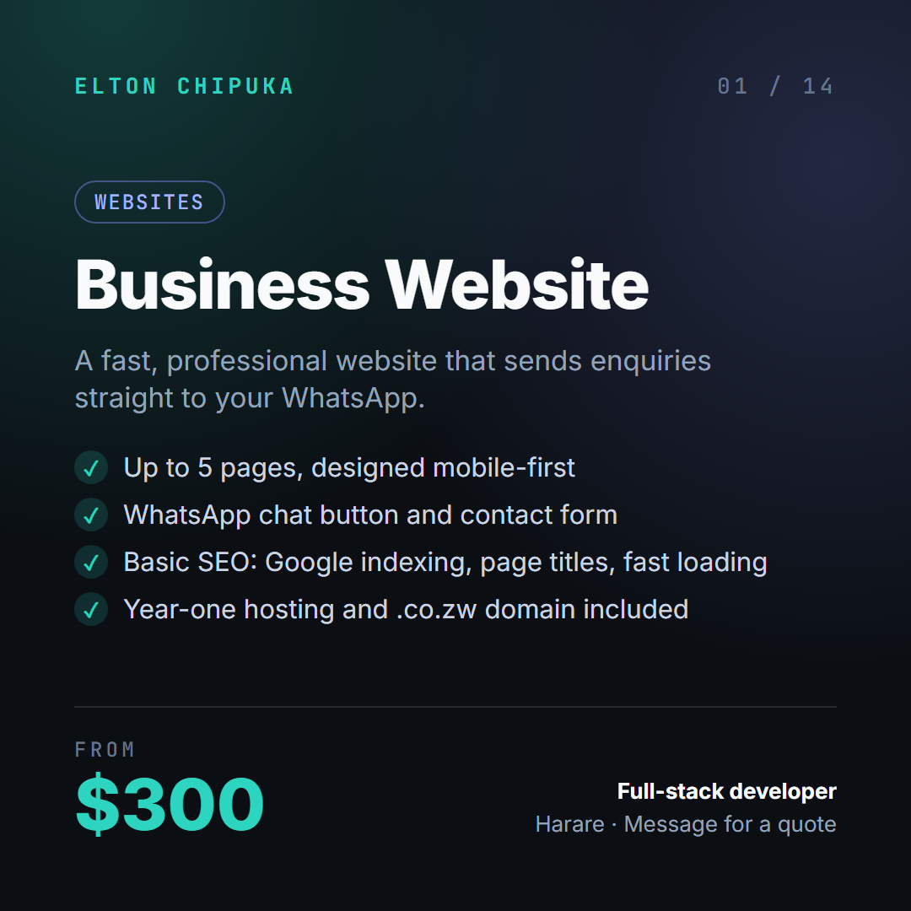

| Field | Value |
| --- | --- |
| Item name | Business Website |
| Price (USD) | 300 |
| Link | https://YOUR-PORTFOLIO-URL/ |
| Item code | EC-WEB-01 |

Description:

```text
A fast, professional website that sends enquiries straight to your WhatsApp.

What's included:
• Up to 5 pages, designed mobile-first
• WhatsApp chat button and contact form
• Basic SEO: Google indexing, page titles, fast loading
• Year-one hosting and .co.zw domain included

Timeline: 1–2 weeks
Proof: My own portfolio site, built with React and TypeScript.
Charged separately: Domain and hosting renewal from year two

Starting price shown. Final quote depends on your requirements. Message me to discuss.
```

## 2. Online Store with Payments

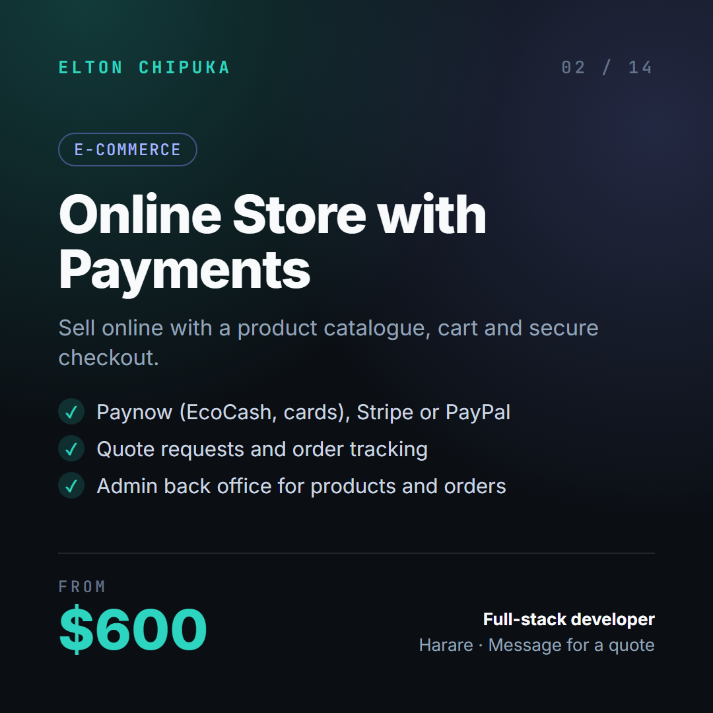

| Field | Value |
| --- | --- |
| Item name | Online Store with Payments |
| Price (USD) | 600 |
| Link | https://YOUR-PORTFOLIO-URL/#projects |
| Item code | EC-SHOP-01 |

Description:

```text
Sell online with a product catalogue, cart and secure checkout.

What's included:
• Paynow (EcoCash, cards), Stripe or PayPal
• Quote requests and order tracking
• Admin back office for products and orders

Timeline: 3–5 weeks
Proof: E-commerce and quotation platform for a curtain design and sales business.
Charged separately: Hosting, domain and payment processing fees

Starting price shown. Final quote depends on your requirements. Message me to discuss.
```

## 3. Custom ERP / Business System

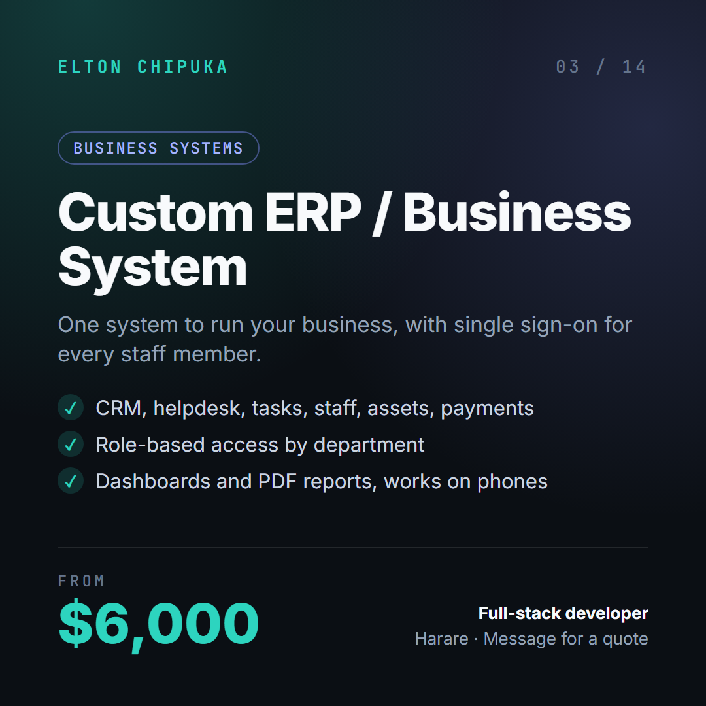

| Field | Value |
| --- | --- |
| Item name | Custom ERP / Business System |
| Price (USD) | 6000 |
| Link | https://YOUR-PORTFOLIO-URL/#projects |
| Item code | EC-ERP-01 |

Description:

```text
One system to run your business, with single sign-on for every staff member.

What's included:
• CRM, helpdesk, tasks, staff, assets, payments
• Role-based access by department
• Dashboards and PDF reports, works on phones

Timeline: 2–4 months, delivered in phases
Proof: Enterprise ERP platform connecting multiple business services in one portal.
Charged separately: Hosting, data migration from old systems and third-party subscriptions

Starting price shown. Final quote depends on your requirements. Message me to discuss.
```

## 4. Helpdesk & Ticketing System

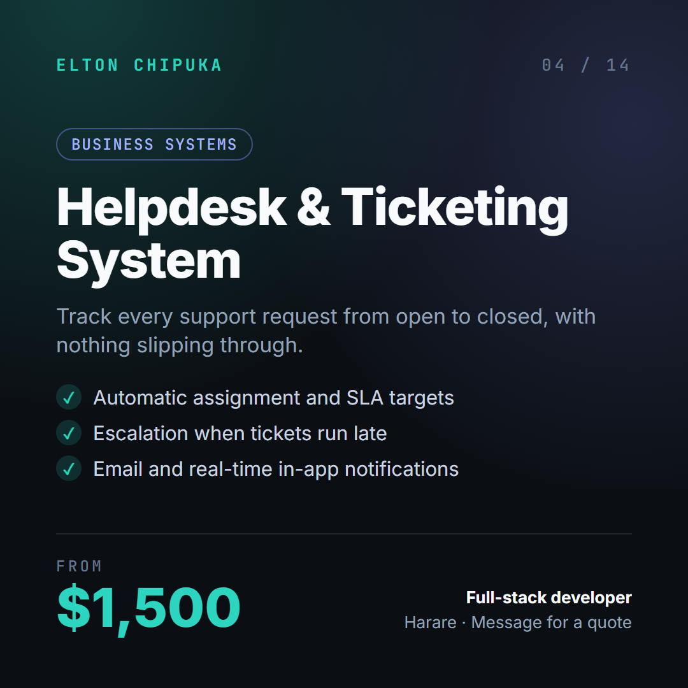

| Field | Value |
| --- | --- |
| Item name | Helpdesk & Ticketing System |
| Price (USD) | 1500 |
| Link | https://YOUR-PORTFOLIO-URL/#projects |
| Item code | EC-HELP-01 |

Description:

```text
Track every support request from open to closed, with nothing slipping through.

What's included:
• Automatic assignment and SLA targets
• Escalation when tickets run late
• Email and real-time in-app notifications

Timeline: 4–6 weeks
Proof: Helpdesk system that cut mean time to resolution by 25%.
Charged separately: Hosting, and email or SMS charges

Starting price shown. Final quote depends on your requirements. Message me to discuss.
```

## 5. CRM & Customer Query System

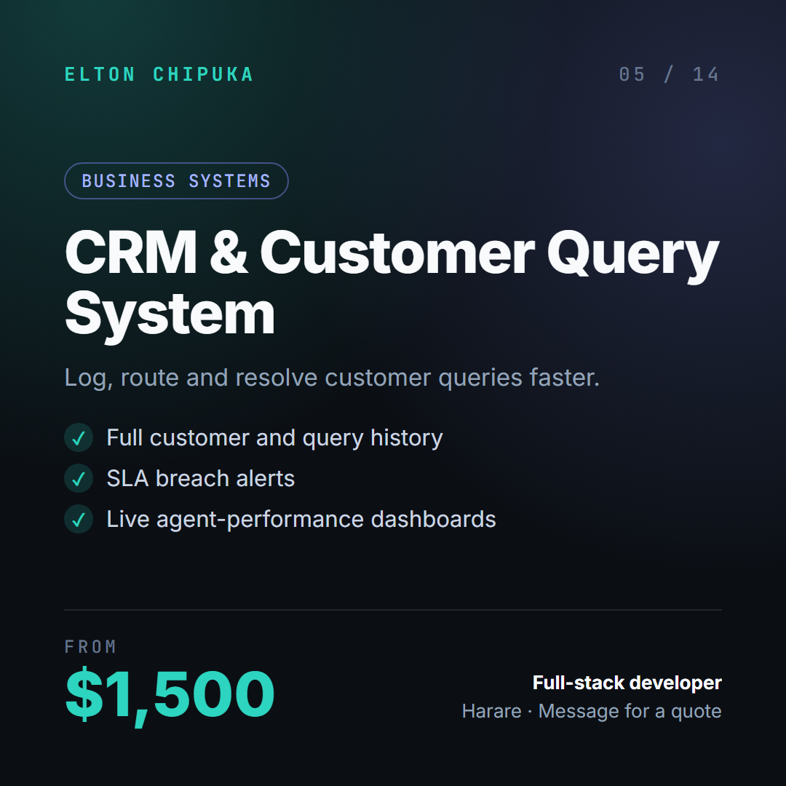

| Field | Value |
| --- | --- |
| Item name | CRM & Customer Query System |
| Price (USD) | 1500 |
| Link | https://YOUR-PORTFOLIO-URL/#projects |
| Item code | EC-CRM-01 |

Description:

```text
Log, route and resolve customer queries faster.

What's included:
• Full customer and query history
• SLA breach alerts
• Live agent-performance dashboards

Timeline: 4–6 weeks
Proof: Customer-care system handling 500+ queries a month, about 30% faster resolution.
Charged separately: Hosting, and email or SMS charges

Starting price shown. Final quote depends on your requirements. Message me to discuss.
```

## 6. Workflow & Approvals Automation

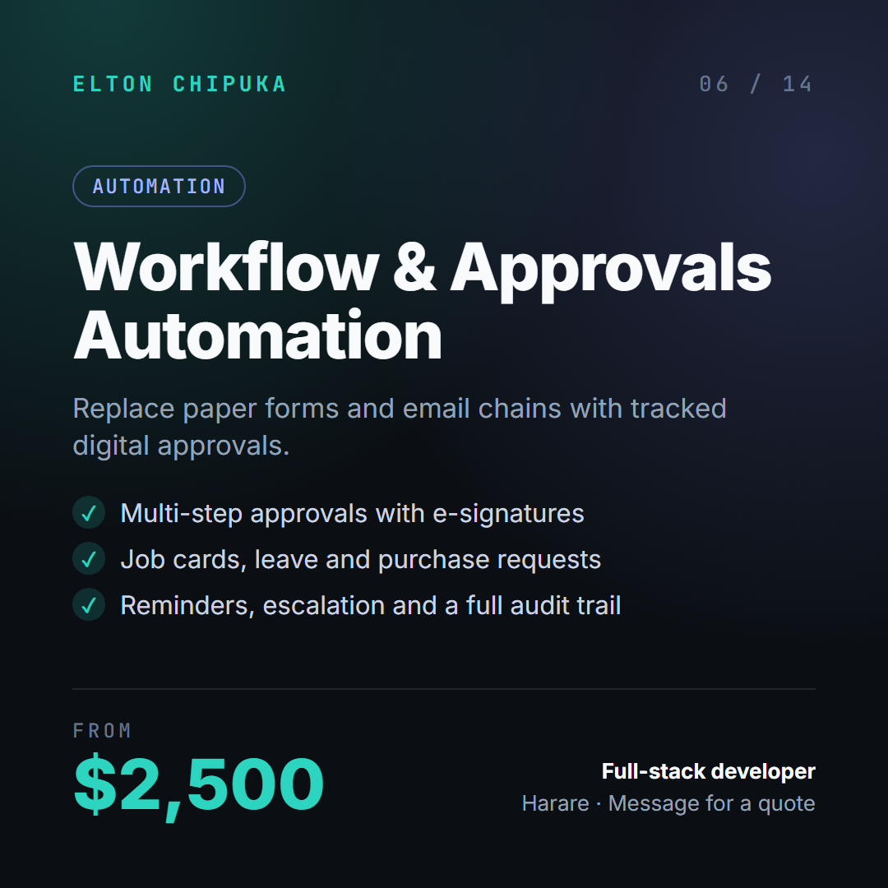

| Field | Value |
| --- | --- |
| Item name | Workflow & Approvals Automation |
| Price (USD) | 2500 |
| Link | https://YOUR-PORTFOLIO-URL/#projects |
| Item code | EC-FLOW-01 |

Description:

```text
Replace paper forms and email chains with tracked digital approvals.

What's included:
• Multi-step approvals with e-signatures
• Job cards, leave and purchase requests
• Reminders, escalation and a full audit trail

Timeline: 6–8 weeks
Proof: Workflow engine powering six business products, from ticketing to performance reviews.
Charged separately: Hosting

Starting price shown. Final quote depends on your requirements. Message me to discuss.
```

## 7. Asset & Equipment Tracking

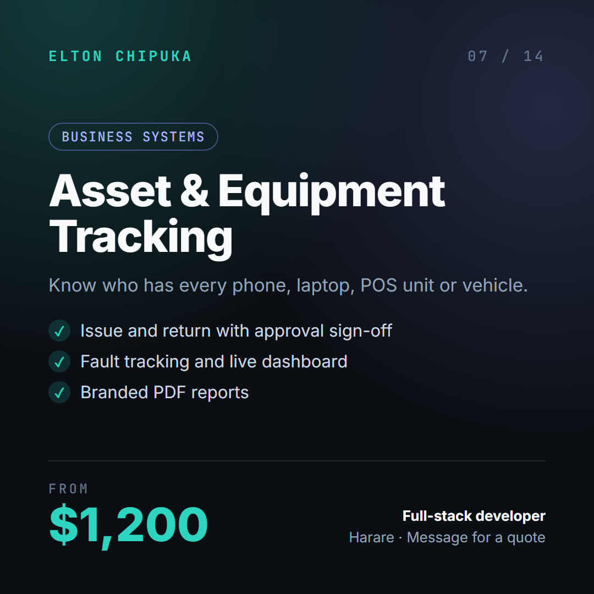

| Field | Value |
| --- | --- |
| Item name | Asset & Equipment Tracking |
| Price (USD) | 1200 |
| Link | https://YOUR-PORTFOLIO-URL/#projects |
| Item code | EC-ASSET-01 |

Description:

```text
Know who has every phone, laptop, POS unit or vehicle.

What's included:
• Issue and return with approval sign-off
• Fault tracking and live dashboard
• Branded PDF reports

Timeline: 3–5 weeks
Proof: Tracks 300+ assets and reduced misplacement by 35%.
Charged separately: Hosting

Starting price shown. Final quote depends on your requirements. Message me to discuss.
```

## 8. Staff Deployment & Performance

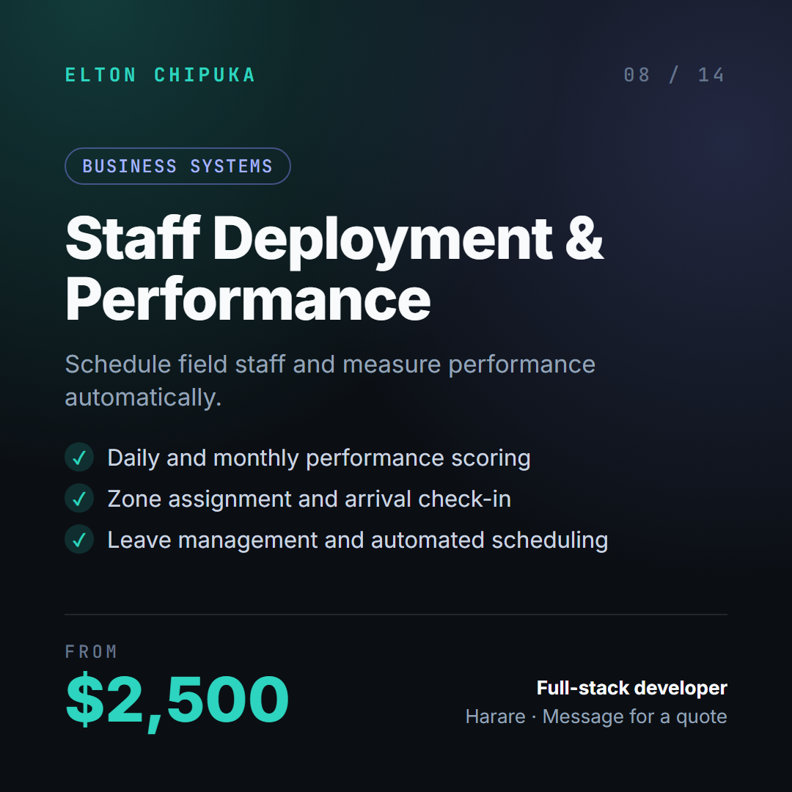

| Field | Value |
| --- | --- |
| Item name | Staff Deployment & Performance |
| Price (USD) | 2500 |
| Link | https://YOUR-PORTFOLIO-URL/#projects |
| Item code | EC-STAFF-01 |

Description:

```text
Schedule field staff and measure performance automatically.

What's included:
• Daily and monthly performance scoring
• Zone assignment and arrival check-in
• Leave management and automated scheduling

Timeline: 6–8 weeks
Proof: Runs 200+ staff across 200+ locations and improved deployment efficiency by about 40%.
Charged separately: Hosting, and SMS charges

Starting price shown. Final quote depends on your requirements. Message me to discuss.
```

## 9. Mobile App (Android & iOS)

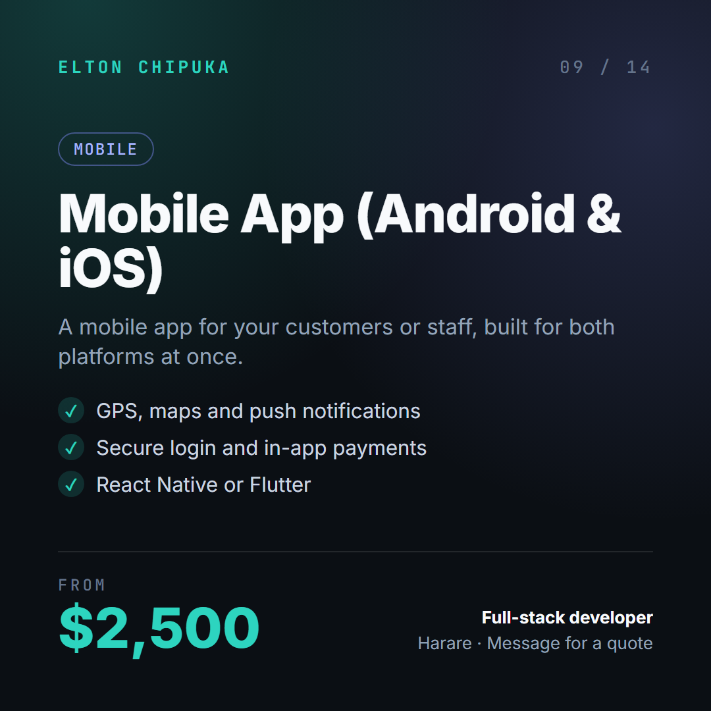

| Field | Value |
| --- | --- |
| Item name | Mobile App (Android & iOS) |
| Price (USD) | 2500 |
| Link | https://YOUR-PORTFOLIO-URL/#projects |
| Item code | EC-APP-01 |

Description:

```text
A mobile app for your customers or staff, built for both platforms at once.

What's included:
• GPS, maps and push notifications
• Secure login and in-app payments
• React Native or Flutter

Timeline: 6–10 weeks
Proof: Park-Check, a GPS smart-parking app with live countdowns and fine payments.
Charged separately: Hosting, plus Google Play and Apple developer accounts

Starting price shown. Final quote depends on your requirements. Message me to discuss.
```

## 10. GPS Tracking & Maps

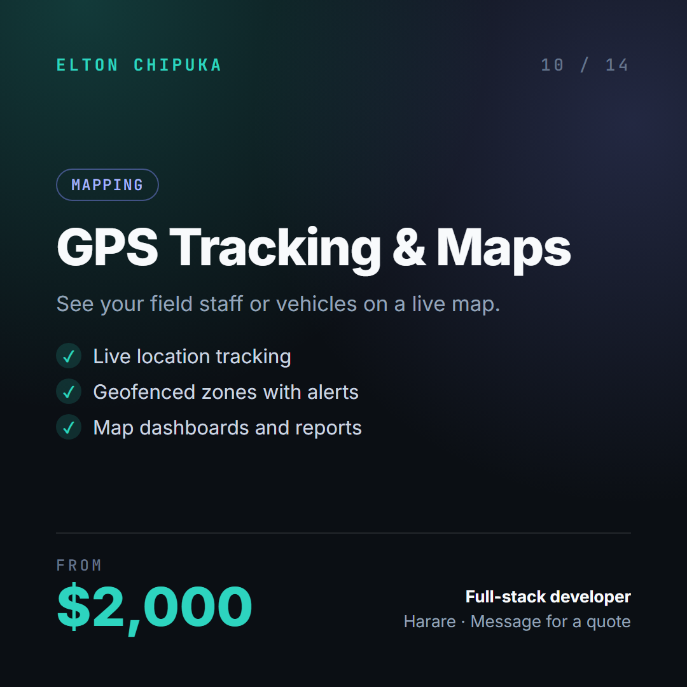

| Field | Value |
| --- | --- |
| Item name | GPS Tracking & Maps |
| Price (USD) | 2000 |
| Link | https://YOUR-PORTFOLIO-URL/#projects |
| Item code | EC-GPS-01 |

Description:

```text
See your field staff or vehicles on a live map.

What's included:
• Live location tracking
• Geofenced zones with alerts
• Map dashboards and reports

Timeline: 4–6 weeks
Proof: Geofencing and live tracking platform for field staff.
Charged separately: GPS hardware, SIM and data charges, and hosting

Starting price shown. Final quote depends on your requirements. Message me to discuss.
```

## 11. Payments & Notifications Setup

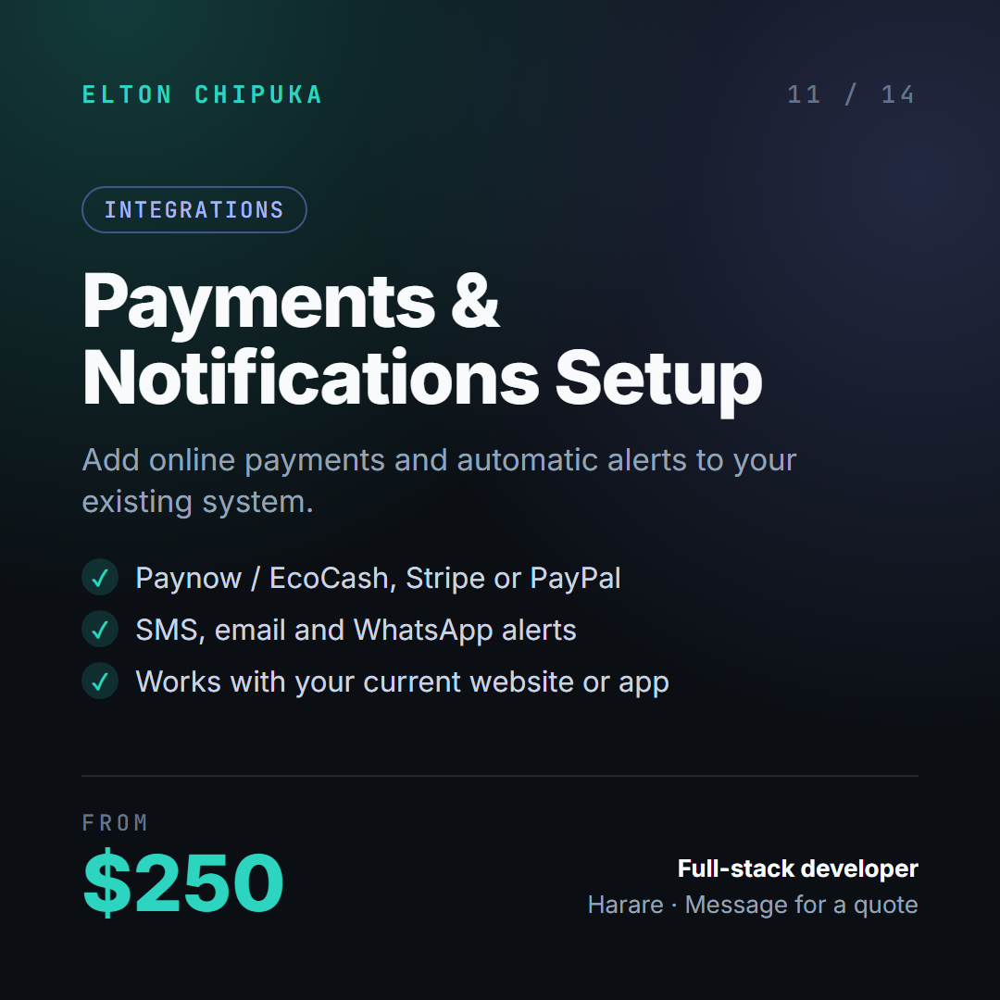

| Field | Value |
| --- | --- |
| Item name | Payments & Notifications Setup |
| Price (USD) | 250 |
| Link | https://YOUR-PORTFOLIO-URL/#projects |
| Item code | EC-INT-01 |

Description:

```text
Add online payments and automatic alerts to your existing system.

What's included:
• Paynow / EcoCash, Stripe or PayPal
• SMS, email and WhatsApp alerts
• Works with your current website or app

Timeline: 1–2 weeks
Proof: Multi-channel notification service sending SMS, email and WhatsApp alerts.
Charged separately: Payment processing fees, and SMS or WhatsApp message charges

Starting price shown. Final quote depends on your requirements. Message me to discuss.
```

## 12. WhatsApp Chatbot

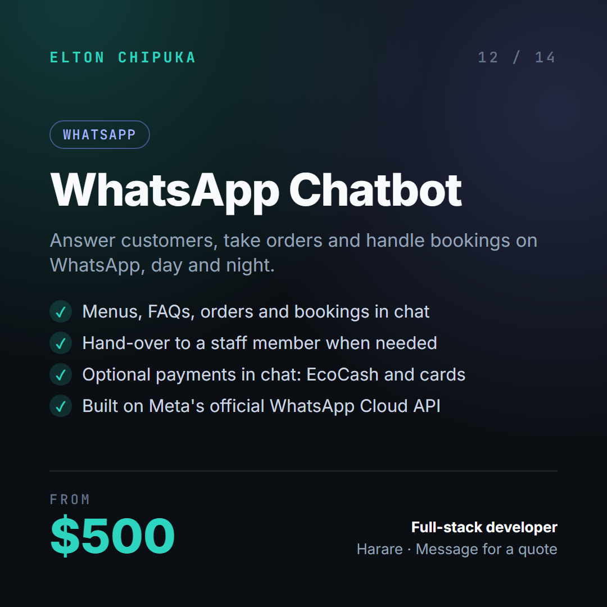

| Field | Value |
| --- | --- |
| Item name | WhatsApp Chatbot |
| Price (USD) | 500 |
| Link | https://YOUR-PORTFOLIO-URL/#contact |
| Item code | EC-BOT-01 |

Description:

```text
Answer customers, take orders and handle bookings on WhatsApp, day and night.

What's included:
• Menus, FAQs, orders and bookings in chat
• Hand-over to a staff member when needed
• Optional payments in chat: EcoCash and cards
• Built on Meta's official WhatsApp Cloud API

Timeline: 2–4 weeks
Proof: Custom chatbots built with Node.js on the WhatsApp Business Cloud API.
Charged separately: Meta's WhatsApp message fees, payment processing fees, a dedicated phone number, and hosting

Starting price shown. Final quote depends on your requirements. Message me to discuss.
```

## 13. Dashboards & Reports

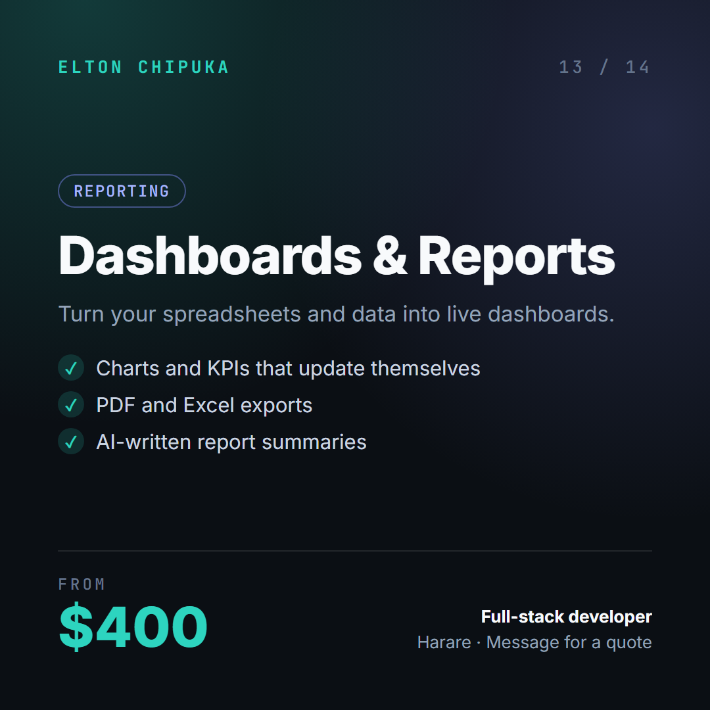

| Field | Value |
| --- | --- |
| Item name | Dashboards & Reports |
| Price (USD) | 400 |
| Link | https://YOUR-PORTFOLIO-URL/#projects |
| Item code | EC-DASH-01 |

Description:

```text
Turn your spreadsheets and data into live dashboards.

What's included:
• Charts and KPIs that update themselves
• PDF and Excel exports
• AI-written report summaries

Timeline: 2–3 weeks
Proof: Reporting engine with period comparisons and AI-generated summaries.
Charged separately: Hosting, and AI usage fees if AI summaries are included

Starting price shown. Final quote depends on your requirements. Message me to discuss.
```

## 14. Monthly Support & Maintenance

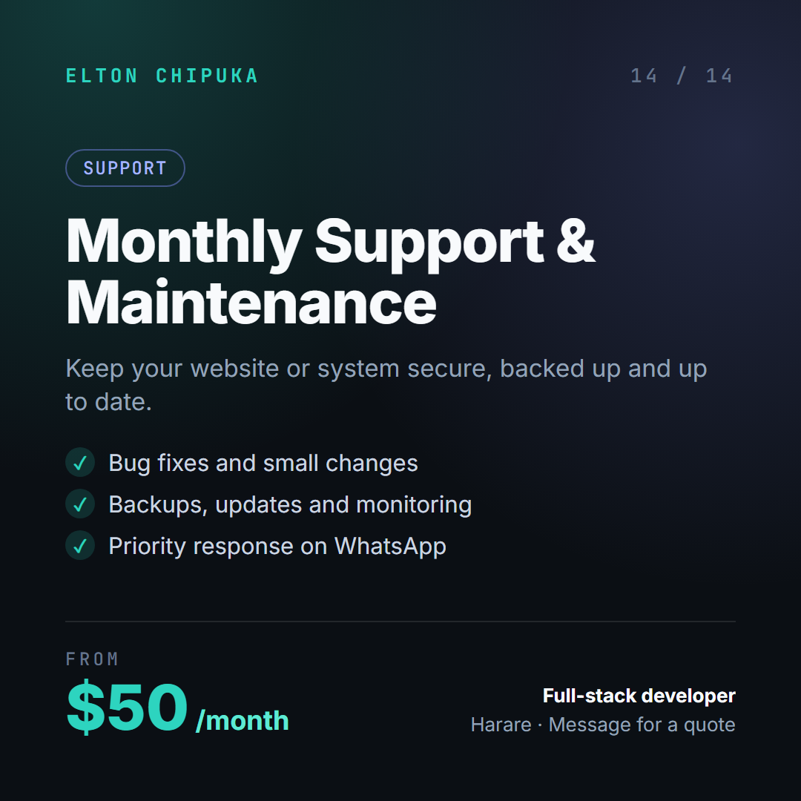

| Field | Value |
| --- | --- |
| Item name | Monthly Support & Maintenance |
| Price (USD) | 50 |
| Link | https://YOUR-PORTFOLIO-URL/#contact |
| Item code | EC-CARE-01 |

Description:

```text
Keep your website or system secure, backed up and up to date.

What's included:
• Bug fixes and small changes
• Backups, updates and monitoring
• Priority response on WhatsApp

Timeline: Monthly, cancel any time
Proof: I maintain production systems used daily by hundreds of staff.
Plan details: Each plan states its support hours, response times and backups

Starting price shown is per month. Final quote depends on your requirements. Message me to discuss.
```
